# design: Fit Clipthrough to every monitor

**Created:** 2026-10-28
**Type:** design (decided 2026-10-28; see [Decisions](#decisions))
**Branch:** `user/asafmahlev/multi-monitor-fit-design`, stacked on `user/asafmahlev/first-run-hotfix` (#3)
**Origin:** "Let's also see how we optimize clipboard to different sized monitors so it would fit
nicely." Part of the road to 1.0.

---

## Summary

Today, Clipthrough fits only screens at least **1100 x 640 DIP**. A screen's DIP size is its pixel
size divided by its scaling. Below that size, the main workspace runs off the screen. The
1280x720 at 150% laptop, a common setup, is also too short for the first-run screen's
**Create library** button and the password prompt's **Unlock** button. Five of the eight dialogs
can also open partly off-screen. On the requester's own portrait screen, Settings opens with
**Save** and **Cancel** off-screen.

The recommended fix is **Option B: a responsive workspace with screen-aware windows**. It has
three width layouts: Wide, which is today's layout; Medium; and Narrow, which stacks the preview
under the list. A Short layout reduces height use. Every window also fits itself to its current
screen whenever it opens, is shown, or changes DPI. A working prototype on this branch has every
key control on-screen in all seven test profiles, from 576 DIP portrait to 3440 DIP ultrawide.
It makes no change at 1100 DIP and wider.

The decisions are recorded in [Decisions](#decisions).

---

## How this was measured

- **Tool:** `Clipthrough.Tests/Layout/LayoutSurveyCapture.cs`. It renders the real windows with
  Avalonia headless and Skia, using an empty temporary database. It does not run live, touch
  Windows display settings, or read real Clipthrough data. It is opt-in and skips by default.
  Regenerate with:

  ```
  $env:CLIPTHROUGH_LAYOUT_CAPTURE_DIR = 'C:\some\scratch\dir'
  $env:CLIPTHROUGH_LAYOUT_CAPTURE_VARIANT = 'current'   # subfolder name
  dotnet test .\Clipthrough.Tests\Clipthrough.Tests.csproj --filter "FullyQualifiedName~LayoutSurveyCapture"
  ```

- **Profiles:** each working area (WA) is the screen in pixels divided by scaling, less a 48 DIP
  taskbar. Rendering uses that profile's scaling (`SetRenderScaling`).

  | id | screen | scaling | working area (DIP) |
  |---|---|---|---|
  | p576 | 1440x2992 portrait (requester's) | 250% | 576 x 1149 |
  | l853 | 1280x720 laptop | 150% | 853 x 432 |
  | w1366 | 1366x768 | 100% | 1366 x 720 |
  | w1536 | 1920x1080 | 125% | 1536 x 816 |
  | w1920 | 1920x1080 | 100% | 1920 x 1032 |
  | w2560 | 2560x1440 | 100% | 2560 x 1392 |
  | u3440 | 3440x1440 ultrawide | 100% | 3440 x 1392 |

- **Model:** the main window is modelled maximized. Its client area is the WA less a 31 DIP
  caption, which is the most room it can get. Owned windows are placed by Avalonia's own
  `CenterOwner` rule from `Window.SetWindowStartupLocation` in 12.1.1: center on the owner, then
  clamp to the WA **only if the window already fits**. A window larger than the screen therefore
  spills over both edges. Windows' own outer-size clamp (`WM_GETMINMAXINFO`) is not modelled.
  This does not overstate the problem: per the F-49 investigation, Avalonia's layout keeps the
  requested size even when Windows clamps the frame, so the same controls remain unreachable.
- **Screenshots:** the WA is outlined in green, and anything outside it is tinted red. Each
  surface's raw numbers are in [measurements-current.md](assets/2026-10-28-multi-monitor-fit/measurements-current.md)
  and [measurements-prototype.md](assets/2026-10-28-multi-monitor-fit/measurements-prototype.md).
  "Lost" counts interactive controls that are off-screen or clipped by a non-scrolling parent.
  Controls in a scroller that can scroll count as reachable.
- **Not covered:** the editor and compare windows are external programs (the configured editor
  and diff tool), not Clipthrough windows, so they are out of scope. The in-app editor is the
  preview pane and is covered as part of the workspace. Headless rendering has no real screens,
  so multi-monitor behaviour is analysed from code below and was not observed live.

---

## 1. Current behaviour

### Main workspace

| profile | window lays out at | off-screen | what is lost |
|---|---|---|---|
| p576 portrait | 1100 x 1118 | **524 DIP right** | search box (91% hidden), all type filters, all search modifiers, most of the preview, footer Settings/Logs, every toast |
| l853 laptop | 1100 x 640 | **247 right, 239 bottom** | Image/Rich/Files, Whole word/Fuzzy/Semantic, 64% of the clip list, footer, list bulk actions |
| w1366 to u3440 | WA | none | nothing |

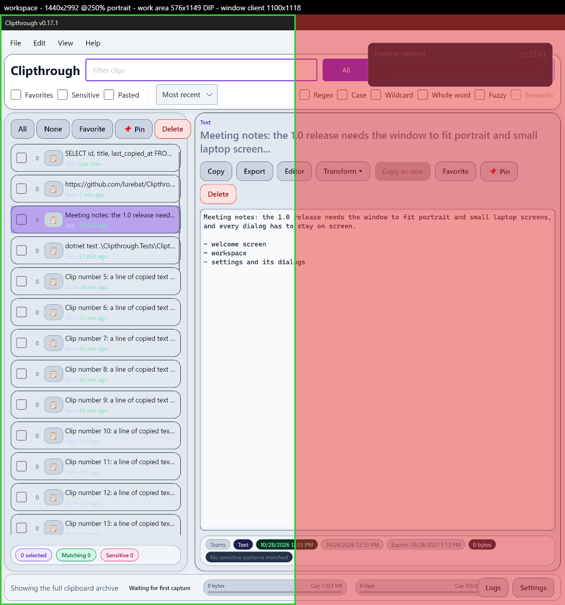
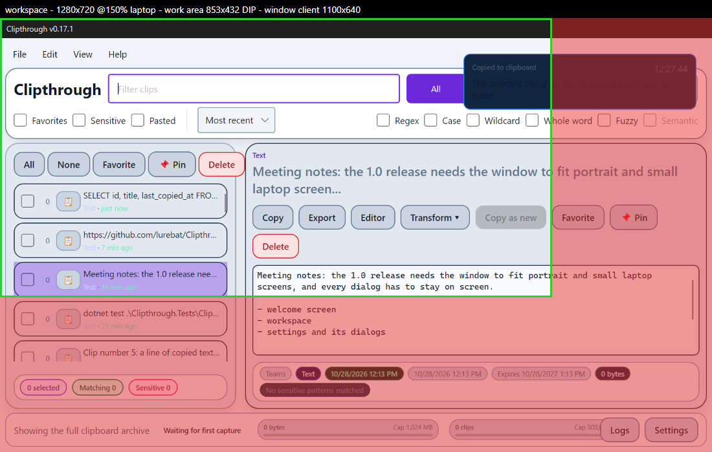

At the wide end, nothing breaks, but space is wasted. On 3440 DIP, each type-filter toggle is
about 380 DIP wide and the search box about 940. Preview lines run about 2200 DIP, which is too
long to read comfortably
([w1920](assets/2026-10-28-multi-monitor-fit/current/workspace-w1920.png),
[u3440](assets/2026-10-28-multi-monitor-fit/current/workspace-u3440.png)).

### Welcome screen and password prompt (full-window overlays)

PR #3 lowered the overlays' minimum width to 480, but their minimum **height** is still 640.

| surface | profile | result |
|---|---|---|
| welcome | p576 | Create library is visible (PR #3). The form keeps 1024 DIP and scrolls sideways, so the database path is 79% hidden until the user scrolls right. |
| welcome | l853 | **Create library is 239 DIP below the screen.** F-49 is still open for short screens. |
| password | l853 | **Unlock and Exit are below the screen.** Enter in the password box still unlocks; a mouse user cannot. |

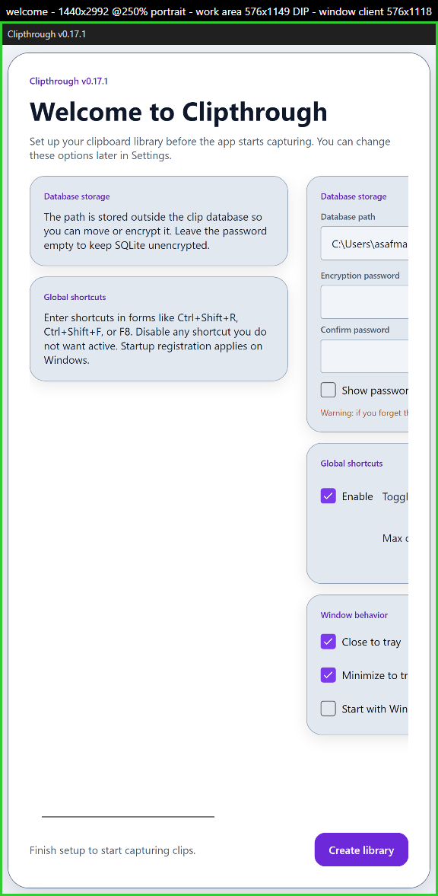
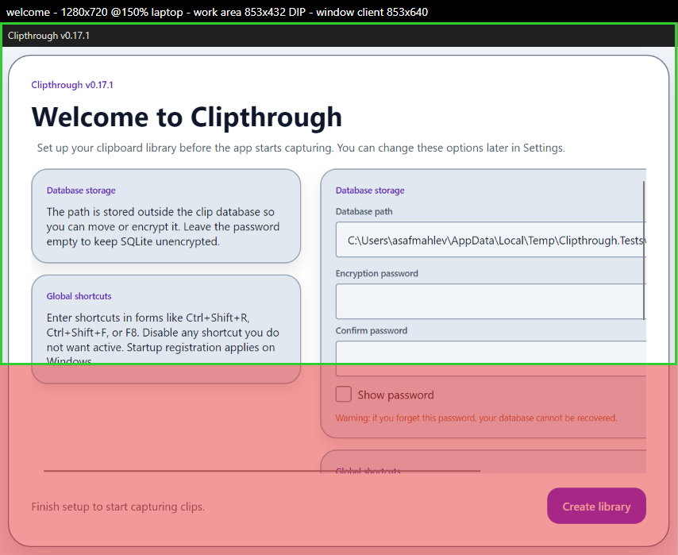
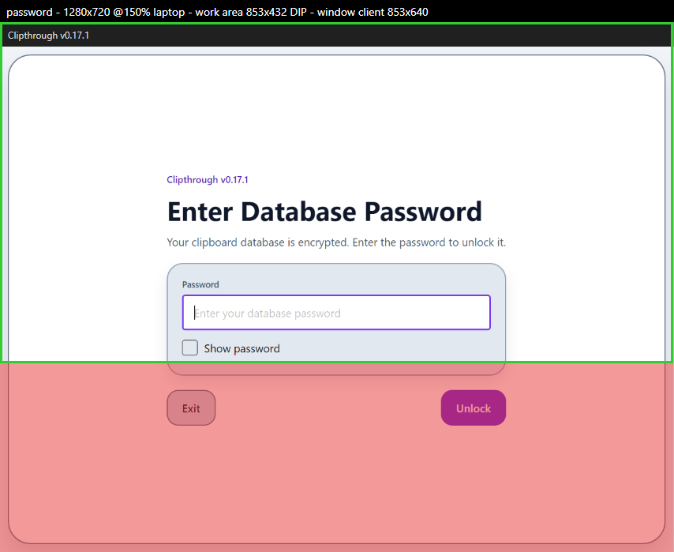

### Settings and its dialogs, Help, Logs, About, AI prompt

| window | requested size / minimum | p576 | l853 | w1366 |
|---|---|---|---|---|
| Settings | 960x720 / 720x480 | **Save, Cancel, Fuzzy off right**; 454 DIP over | **Save, Cancel off bottom**; title bar 9 DIP above the screen | title bar 15 DIP above the screen |
| Re-encrypt (from Settings) | 460 x content (~486) | fits | **Re-encrypt and Cancel off bottom** | fits |
| Confirm (from Settings) | 440 x content | fits | fits | fits |
| Session logs | 1080x680 / 720x420; toolbar fixed 420+160 | **Copy All and level filter off right** | 237 right, 279 bottom over | fits |
| Help | 780x640 / 520x380 | 364 DIP off right (text scrolls) | 239 DIP off bottom | fits |
| About, AI prompt | 460x320, 560 x content | fit | fit | fit |

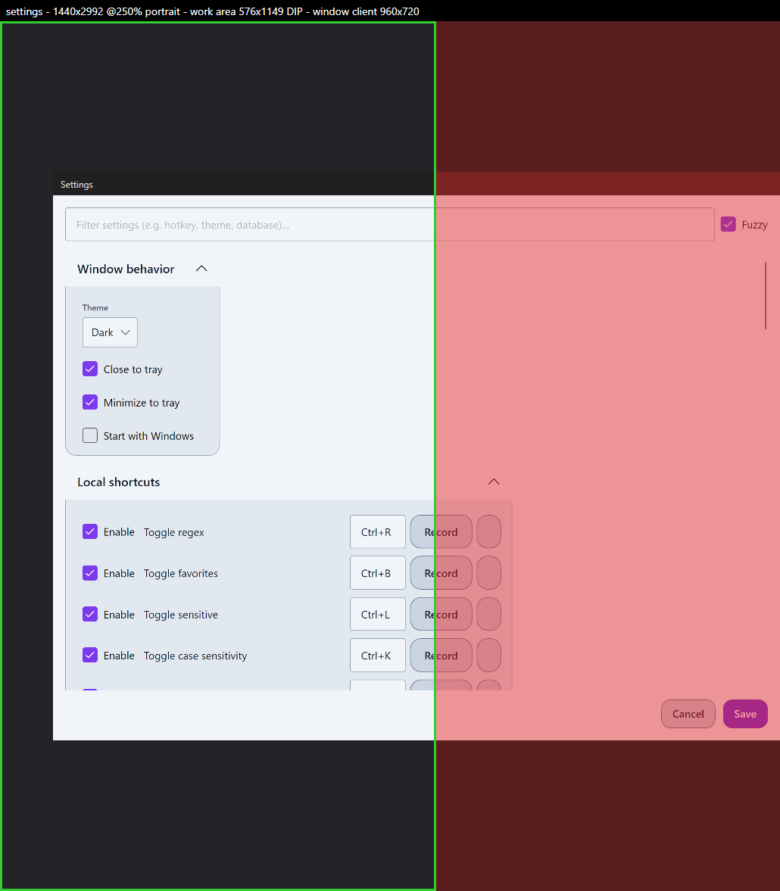
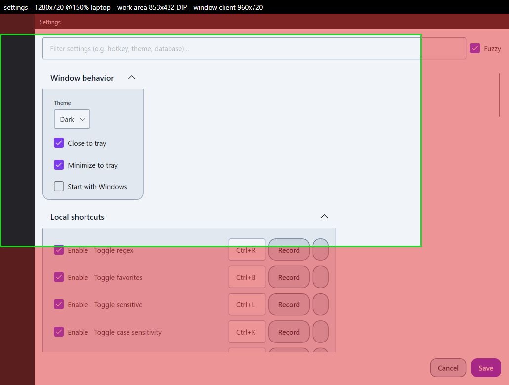
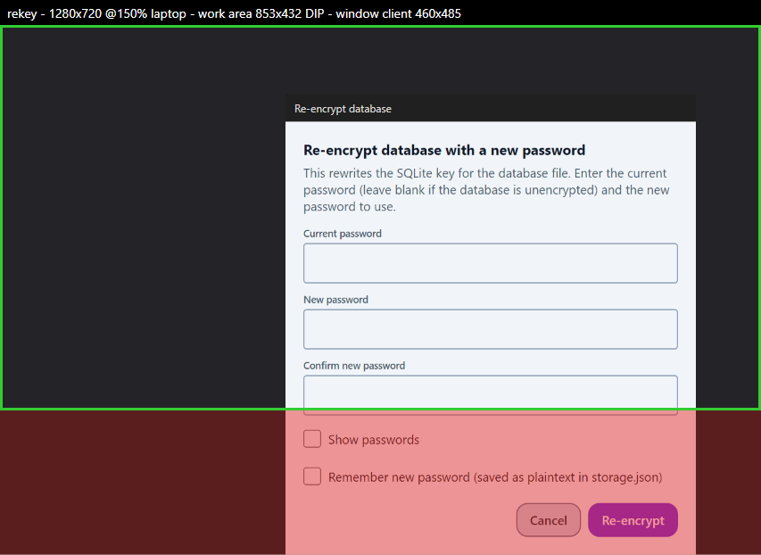
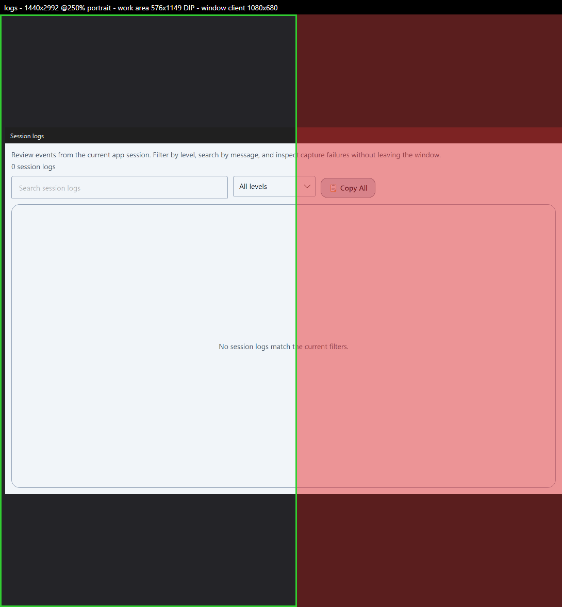

### Context menus and toasts

- **Clip context menu:** it is about 210x300 DIP at every profile and fits all of them. Avalonia
  constrains popups to the screen, so no change is needed.
- **Toasts:** each is a fixed 360 DIP wide, anchored to the window's top-right corner. When the
  window overflows (p576), every toast is drawn **entirely off-screen**. At all sizes, a toast
  covers the Rich/Files toggles while it is shown.

### Multi-monitor (code analysis; not observed live)

Clipthrough **does not persist window geometry**. Every launch opens at the 1360x860 default,
which #3 then fits once. After that, the window is hidden to the tray and shown again.

1. **Wrong-unit placement near the caret (`App.PositionWindowNearCaret`, App.axaml.cs).** This
   runs on every toggle-hotkey show. It compares `window.Width`, a requested size in **DIP**,
   with the pixel working area and pixel caret. At 250% it positions a window it believes is
   1360 px wide, which is the default `Width` for a window first opened on a 100% monitor. The
   window is actually at least 1100 DIP = 2750 px. With the caret at x=100 px on the 1440 px
   portrait screen, it picks x = min(100, 1440-1360) = 80 px. That leaves **1390 px (556 DIP)
   past the right edge**. A `Width` of 576 set by #3's fit gives a similar result: x=100, with
   1410 px over. When the caret is on another monitor, it also uses that monitor's pixel bounds
   with no scaling at all.
2. **Fit runs once.** `MainWindow.FitToWorkingArea` is guarded by `m_fittedToWorkingArea`. It
   does not run when the window is shown again, moved to another monitor, or after a DPI change.
   `ShowMainWindowFromTray` does not reposition the window at all.
3. **Moving between DPIs keeps the DIP size.** A 1360 DIP window dragged from a 2560@100% screen
   to the 250% portrait screen becomes 3400 px wide on a 1440 px screen. Today the 1100 DIP
   minimum stops the user from shrinking it to fit.
4. **A monitor that disappears while Clipthrough is hidden in the tray.** The hotkey path moves
   the window to the caret's screen, with the unit bug in item 1. The tray path shows it at its
   stale position. Whether Windows itself relocates a *hidden* window off a removed monitor
   remains unverified. Answering that needs a live run with an exclusive window; see
   [Live verification](#live-verification-not-yet-run).

---

## 2. What breaks

| # | element | problem | where |
|---|---|---|---|
| B1 | workspace minimum width 1100 DIP | Larger than any WA under 1100 DIP, so the workspace runs off-screen and the right half is unreachable | `MainWindow.axaml` `Window.workspace` style |
| B2 | window minimum height 640 DIP | Taller than short WAs (1280x720@150% = 401 client; 1366x768@125% = 535). The bottom of the workspace, Create library, and Unlock go off-screen | `MainWindow.axaml` `Window` style |
| B3 | hero toolbar row 1 | Title, search (MinWidth 360), and five toggles share one row; nothing reflows | `MainWindow.axaml` hero `Grid ColumnDefinitions="Auto,*,*"` |
| B4 | filter row | Its WrapPanels sit in `Auto` columns, so they are measured at infinite width and **never wrap** | hero `Grid ColumnDefinitions="Auto,Auto,Auto,*,Auto"` |
| B5 | pane minimums 340 + 620 | 966 DIP before margins; the split cannot narrow or stack | list and preview `Border MinWidth` |
| B6 | footer usage cards | Two cards at MinWidth 280 each (576 DIP for two meters) in a single row | footer `detail-stat-card` |
| B7 | toasts | Fixed `Width="360"`, anchored to the window's right edge. They are off-screen whenever the window overflows, and they cover the type toggles | notifications `ItemsControl` |
| B8 | welcome form | Keeps its 1024 DIP minimum below that width and scrolls sideways instead of stacking | `WelcomeColumns`, PR #3 |
| B9 | password prompt | Centered, not scrollable, so Unlock goes off-screen on short WAs | password `Border` |
| B10 | Settings | 960x720 default; minimum 720x480 exceeds p576 and l853; not fitted | `SettingsWindow.axaml` |
| B11 | Settings hotkey rows | Fixed 260 DIP label column plus HotkeyBox overlap below about 640 DIP. This persists after the window is fitted | `SettingsWindow.axaml` hotkey grids, `TextBox MinWidth="500"` |
| B12 | Session logs | 1080x680 default, minimum 720; toolbar fixed `Width="420"` + `Width="160"` | `SessionLogsWindow.axaml` |
| B13 | Help | 780x640 default, minimum 520x380 | `HelpWindow.axaml` |
| B14 | Re-encrypt dialog | Sized to content (~486 DIP), not scrollable, so its buttons go off-screen on short WAs | `RekeyDialog.axaml` |
| B15 | owned-window placement | Avalonia's `CenterOwner` does not clamp a window larger than the WA, so title bars can sit above the screen and cannot be dragged | all dialogs |
| B16 | caret placement | Mixes DIP and pixels; ignores minimum size and target-screen scaling | `App.PositionWindowNearCaret` |
| B17 | one-shot fit | No re-fit when shown again, on a DPI change, or after a screen change | `MainWindow.OnOpened` |
| B18 | wide-screen waste | Type toggles, search box, and preview line length grow without limit on 2560+ | hero toolbar, preview |

---

## 3. Options

### Option A: Fit the windows, keep the layout

- Fit every window to its current screen whenever it opens or is shown, and after a DPI or
  screen change.
- Fix caret placement.
- Make dialogs scroll.
- Below 1100x640, put the workspace in a two-way `ScrollViewer` instead of letting it run
  off-screen.

| + | - |
|---|---|
| Smallest change; no new layout states | On the requester's own screen, the workspace becomes an 1100 DIP canvas that scrolls sideways, so search, filters, and the preview are always half-hidden |
| Wide layout is untouched | Toasts and footer need scrolling to reach; short laptops show about 3 clips |
| Low test cost | Does not address B3 to B8 or B18; it hides them behind scrollbars |

### Option B: Responsive workspace plus screen-aware windows (recommended)

Includes everything in A except the workspace scroller, plus these breakpoints computed from the
client size:

| breakpoint | condition | layout |
|---|---|---|
| **Wide** | width >= 1100 | **Today's layout, unchanged** |
| **Medium** | 760 to 1100 | Title hidden (the caption already shows it). Search modifiers move to a second filter row, and their WrapPanels now wrap. Split becomes 2:3, with pane minimums 260/360. Filter summary hidden; usage cards narrower |
| **Narrow** | < 760 | Search on its own row with the type toggles below. **Preview stacked under the list**, with a horizontal splitter. Footer cards stack under the footer row. Welcome form above the explanatory text |
| **Short** | height < 600 | Footer, list counters, and preview metadata chips hidden. Settings and Logs remain in File and View |

The window minimum becomes **480 x 360**. Dialogs get lower minimums and the same fit, and they
scroll where their content can exceed the screen.

| + | - |
|---|---|
| Every key control on-screen in all 7 profiles (prototype, below) | Four layout states to keep tested |
| Wide (1100+) pixel-for-pixel as today | Short hides the footer meters and counters (a UX call) |
| Portrait becomes a natural list-over-preview layout | Avalonia cannot style grid definitions, so moving panes needs code-behind (or a small attached helper) |
| Scales to the ultrawide caps in B18 if wanted | Settings still needs its own narrow pass (B11) |

### Option C: Compact quick-paste mode

Below a breakpoint, the window switches to a compact mode:

- Only search and the clip list remain.
- The preview opens on demand as an overlay or drawer.
- Category filters, sort, and search modifiers move into one **Filters** flyout.
- It is similar to Win+V or Ditto.

| + | - |
|---|---|
| Works down to about 360 DIP wide and about 300 high | Largest UX change; previewing takes an extra action |
| Feels right for a hotkey popup | New UI to build and test (flyout, drawer, state) |
| | Two quite different apps to keep consistent |

### Orthogonal choice D: remembering window geometry

Clipthrough does not remember window geometry today. The choices are:

- **D0:** keep it that way.
- **D1:** remember the last normal size and the maximized state, then **clamp to the current WA**
  on restore.
- **D2:** D1, keyed by monitor configuration, so a docked laptop and the same laptop undocked
  each remember their own size.

D1 is cheap once the fit helper exists. D2 adds a settings schema and a monitor-identity
question.

---

## 4. Prototype (Option B)

The prototype is in this branch's prototype commit and is **not for merge as is**. Captured with
the same tool and model (`CLIPTHROUGH_LAYOUT_CAPTURE_VARIANT=prototype`):

| surface | p576 | l853 | w1366 to u3440 |
|---|---|---|---|
| workspace | 0 lost (was 19) | 0 lost (was 11) | 0 lost, Wide layout unchanged |
| welcome | 0 lost, no sideways scroll | **Create library on-screen** | 0 lost |
| password | 0 lost | **Unlock on-screen** | 0 lost |
| Settings | **Save/Cancel on-screen**; hotkey rows overlap (B11 remains) | Save/Cancel on-screen | 0 lost |
| Re-encrypt | fits | buttons on-screen; fields scroll | fits |
| Session logs | Copy All on-screen | fits | fits |
| Help | fits width | fits height | fits |

Narrow extreme (requester's portrait screen):

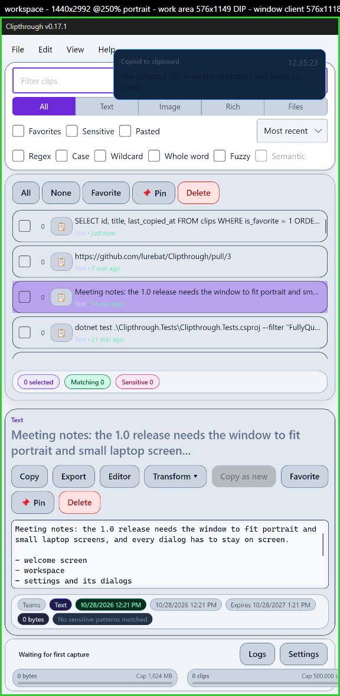
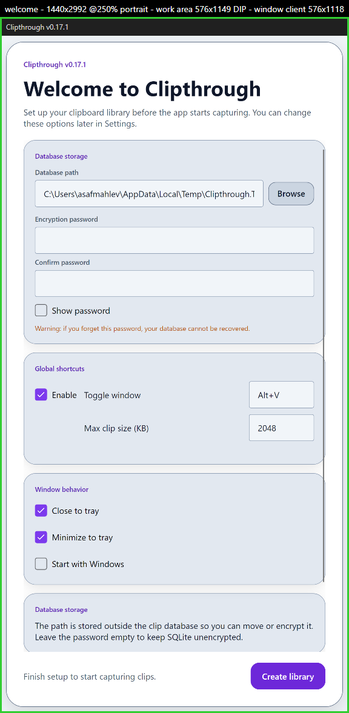
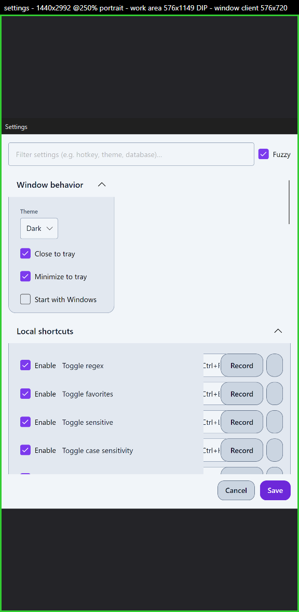

Short, medium laptop:

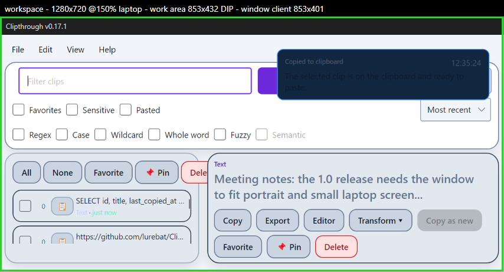
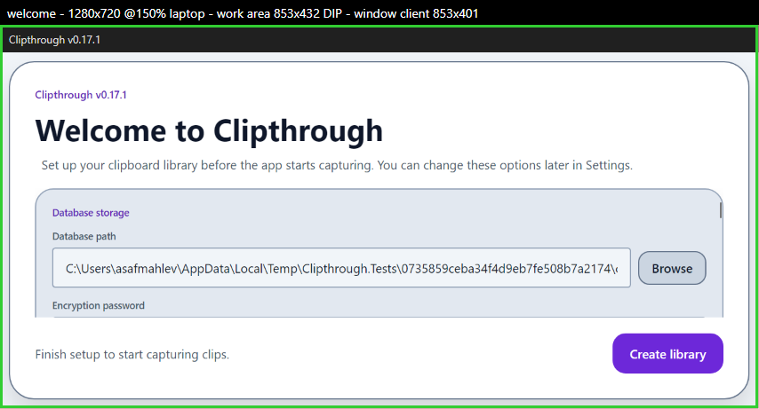
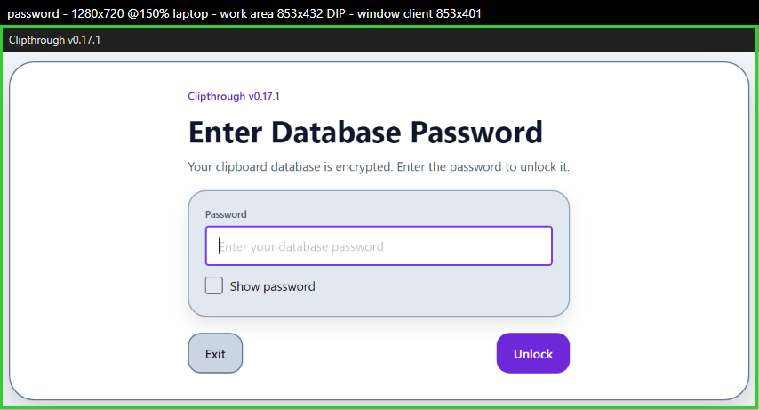
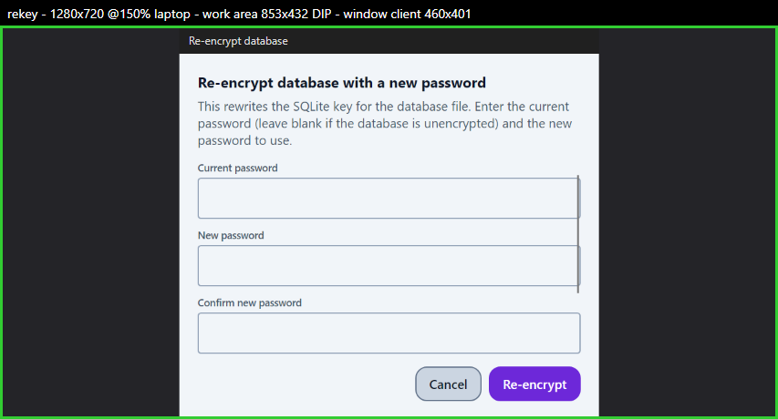

Wide extreme (unchanged layout; B18 caps not prototyped):

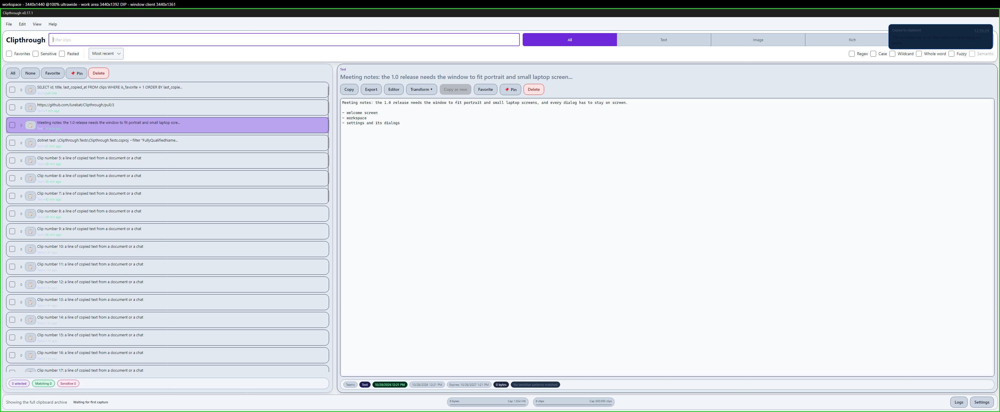

**What the prototype shows is still weak:**

- On the 1280x720 laptop, the workspace is usable but cramped, with about 2 clips visible. The
  hero toolbar uses three rows. Two possible improvements are a **Search options** button that
  collapses the six modifiers, which saves about 40 DIP, or Option C's compact mode for Short.
- Settings hotkey rows overlap below about 640 DIP (B11).
- Toasts still cover the type toggles (B7, second half).
- The prototype does not include the caret-placement fix, the repeated fit (B16, B17), or
  geometry memory. Those are geometry-only changes, planned in units U1, U2, and U8 below.
- In the capture, the dialog fit is *modelled*: the tool runs the real fit geometry
  (`MainWindow.FitToWorkingArea`) against the modelled screen, because headless has no real
  screens. The runtime hook (`WorkingAreaFit.Attach`) is wired into every dialog but was not
  exercised live.

---

## 5. Recommendation

Adopt **Option B with D1** (remember the last size and the maximized state, clamped to the
current WA). Consider the B18 caps for wide screens. For the 1280x720 laptop, add a **Search
options** flyout in Short rather than adopting all of Option C. Option C remains a good later
addition as an explicit "compact popup" setting, and B leaves room for it.

## 6. Implementation outline (test-first)

Each unit is written failing first, with a mutant in `Clipthrough.Tests/Mutation/mutants.json`
per AGENTS.md. On-screen assertions reuse the logic of `LayoutSurveyCapture.Classify`: visible
fraction after ancestor clipping and the WA. Promote it to a shared test helper,
`OnScreen.AssertReachable(control, workArea)`.

1. **U1: Geometry helper.** Move `MainWindow.FitToWorkingArea` into `Views/WindowGeometry.cs`.
   - Extend it to respect `MinWidth`/`MinHeight`. If even the minimum does not fit, return
     *maximize*.
   - Add `PlaceNearCaret(caretPx, frameDip, screen)`, which converts with the **target** screen's
     scaling (fixes B16).
   - Unit tests cover 576@2.5, 853@1.5, a secondary screen at negative coordinates, and a caret
     on a 100% screen while the window sits on a 250% screen. Add an explicit regression for
     today's 556 DIP overflow.
2. **U2: Fit triggers.** Fit when the window opens, is shown from the hotkey or tray, changes
   scaling, or after `Screens.Changed` (fixes B15 and B17).
   - Inject the screen so headless tests can supply a WA.
   - Tests: a window fitted at scaling 1.0 then switched to 2.5 (`SetRenderScaling`) ends within
     the WA. A tray-show after the screen shrinks ends within the WA.
3. **U3: Breakpoint classifier.** `WorkspaceBreakpoints.Classify`, with boundary tests at
   759.9/760, 1099.9/1100, and 599.9/600.
4. **U4: Responsive workspace.** Headless tests at 576x1118, 853x401, 1000x700, 1366x689, and
   3440x1361 assert that each key control is reachable: search, every type toggle, sort, every
   modifier, at least N clip rows, the preview content at a minimum height, Copy/Delete, and
   Settings via the footer or the File menu.
   - Add a **Wide-unchanged** golden-geometry test: the 1:2 split and the toolbar positions at
     1366 and 1920.
   - Replace `TheWorkspaceKeepsItsMinimumWidth` (1100) with a 480 assertion.
5. **U5: Overlays.** Extend `WelcomeNarrowWorkAreaHeadlessTests` to 853x401: Create library and
   Unlock on-screen, and no sideways scroll at 576.
6. **U6: Dialogs.** For each window at p576 and l853:
   - Its action buttons are on-screen after the fit. These are Settings Save/Cancel, Re-encrypt
     Re-encrypt/Cancel, Logs Copy All, and Help scrolling.
   - The Settings narrow pass: hotkey rows wrap below 640 DIP (B11).
7. **U7: Toasts.** Width is `min(360, window - 32)` and lies within the window. Moving them away
   from the toolbar is decision 4.
8. **U8 (if D1/D2): Geometry persistence.** Add an `AppSettings` field and a restore-then-clamp
   step. Tests: a saved rect on a now-missing monitor restores onto the current one, and a saved
   rect larger than the WA is clamped.
9. **U9 (if approved): Wide caps (B18).** Add `MaxWidth` on the type toggles and search box, and
   an optional preview reading width.

Keep `LayoutSurveyCapture` as the opt-in screenshot tool. Re-run it before and after each unit,
and attach the images to the PR.

## Live verification (not yet run)

These need a live window and an exclusive slot. Use an isolated profile: redirect `APPDATA` and
`LOCALAPPDATA` for the process. Never change display settings; use a second monitor that is
already attached.

- Toggle-hotkey show with the caret on the portrait screen (B16).
- Drag the window between monitors with different DPI (multi-monitor item 3).
- Hide to the tray, disconnect the monitor, then show from the tray (multi-monitor item 4). This
  answers whether Windows relocates a hidden window.

---

## Decisions

Asaf decided all six on 2026-10-28:

1. **Direction:** Option B.
2. **Short screens:** collapse the six search modifiers into a **Search options** button, and hide the footer meters and the counters. Settings and Logs stay reachable from the File and View menus.
3. **Narrow order:** the preview goes below the list, with a draggable splitter, as prototyped.
4. **Toasts:** move to the bottom-right.
5. **Geometry memory:** D1. Remember the last normal size and the maximized state, clamped to the current working area on restore.
6. **Wide screens:** cap the toggle, search and preview widths (B18). The caps are 900, 960 and 1600 DIP, so they change nothing up to 1920 DIP.

## Implementation decisions

These were made during implementation, within the approved scope:

- The prototype commit was not merged. Its layout was rebuilt as `MainWindow.Layout.cs`, `WorkspaceBreakpoints`, `WindowGeometry` and `WindowFitter`.
- The geometry is remembered in a separate `window.json`, not in `AppSettings`. The window moves on every hotkey show, and a settings save re-applies hotkeys, theme and capture rules to everything listening.
- When a window's minimum size cannot fit the screen, the fit pins the window's top-left to the working area, so its caption and menu stay reachable.
- A DPI change only resizes a window that no longer fits. It does not move one that merely hangs off an edge, so it does not fight a drag between monitors.
- The Search options flyout duplicates the six modifier check boxes and binds them to the same properties. Avalonia cannot move one control between the toolbar and a flyout, so there are two sets of controls.
- The Settings hotkey rows changed from a fixed 260 DIP label column to 2*:3*, with wrapping labels and a 220 DIP minimum on the hotkey column. Settings' minimum width is 520 DIP, which fits the 576 DIP portrait screen. At its 960 DIP default the window looks almost unchanged.
- The window minimum is 480x360 DIP. Narrow and Short together (a window resized below 760x600) cannot stack the list and preview at a useful height, so there the list-and-preview area keeps 520 DIP and scrolls. Nothing else scrolls.
- The list pane's bulk actions (All, None, Favorite, Pin, Delete) now wrap. In a narrow list pane, Delete used to run under the preview.
- In Short, the preview title is trimmed to one line, so the preview content keeps its height.
- On 2560+ DIP screens, a thin spacer column between the search box and the type toggles takes the space their caps leave, so the toggles stay at the right edge. That adds one 10 DIP column gap to the Wide toolbar at every width.
- The test suite now loads the app's Inter font (`.WithInterFont()`, as `Program.cs` does). Without it, headless falls back to a stub font about 1.6 times as wide, and layout tests measured text that does not exist. Moving the whole suite to Skia was measured and rejected: it broke 6 image tests that rely on the stub renderer, and the suite ran 60% slower.

## Result

The same capture tool, run against the implementation, finds every key control on-screen in all seven profiles. See [measurements-implemented.md](assets/2026-10-28-multi-monitor-fit/measurements-implemented.md).

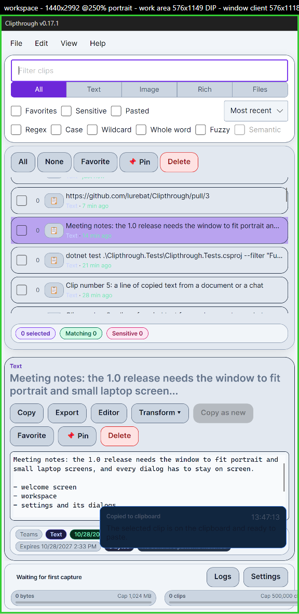
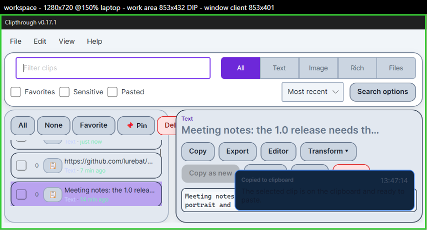
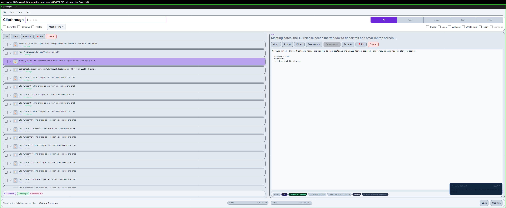
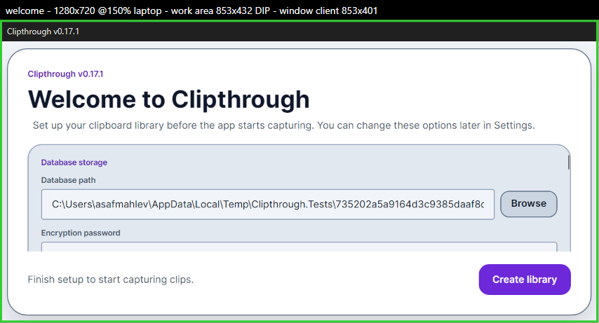
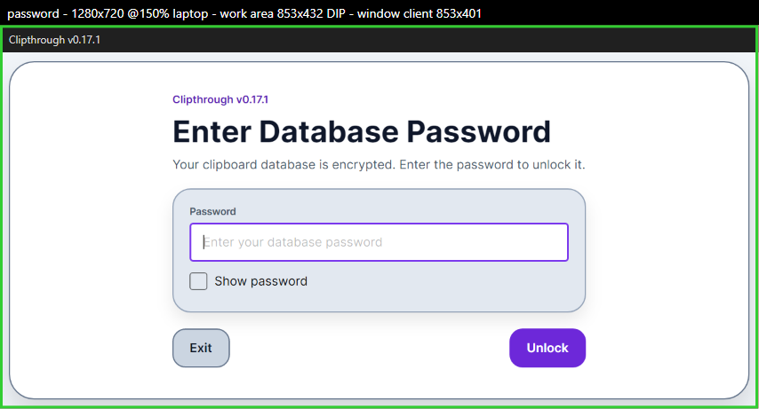
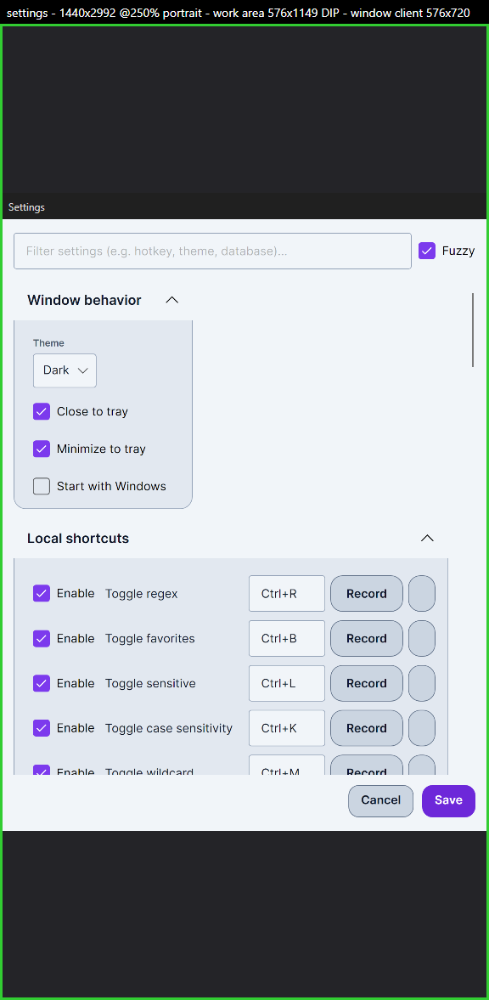
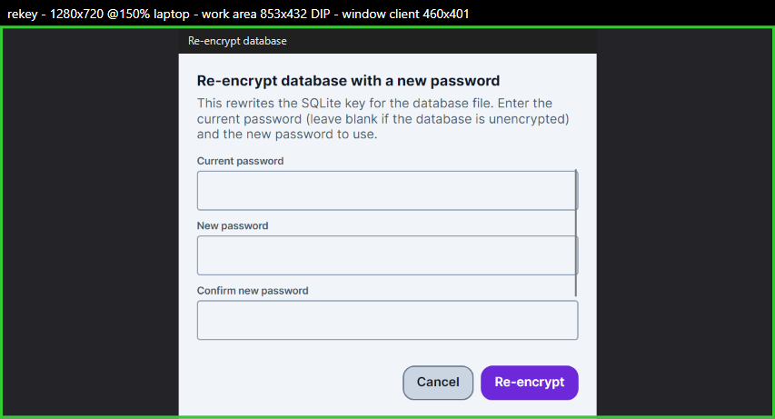

## Live re-checks (pending; batched for the live window)

These need a real desktop: an isolated profile with `APPDATA` and `LOCALAPPDATA` redirected, and an existing second monitor. Display settings must not be changed.

1. Toggle-hotkey show with the caret on the 250% portrait screen: the window opens beside the caret and inside the screen (B16).
2. Drag the window from a 100% monitor to the 250% portrait one: it shrinks to fit, and the drag is not fought.
3. Hide to the tray, disconnect a monitor, then show from the tray: the window comes back on a connected screen.
4. Quit while maximized, then restart: the window opens maximized, and un-maximizing returns it to the remembered normal size.
5. First run on 1280x720 at 150%: Create library and Unlock are on-screen in a real window.
6. Settings, Re-encrypt and Session logs on the portrait screen: each opens fitted, with its buttons on-screen.